# Reservo

**Multi-tenant booking & scheduling SaaS for service businesses** (clinics, salons, studios).
Each business gets a public booking page, a shared team calendar, deposits through Stripe and
automatic confirmation/reminder emails, on a backend designed so that the things that
must never go wrong (double bookings, cross-tenant data leaks, lost or duplicated payments)
are guaranteed by the database instead of hoped for in application code.

[](https://github.com/MatheoTe/reservo/actions/workflows/ci.yml)


| Layer       | Choice                                                                         |
| ----------- | ------------------------------------------------------------------------------ |
| App         | Next.js 16 (App Router, Server Components, Server Actions), React 19           |
| Language    | TypeScript (`strict`, `noUncheckedIndexedAccess`), zod 4 at every boundary     |
| UI          | Tailwind CSS 4, shadcn/ui-style components on Radix primitives                 |
| Data        | PostgreSQL 17, Drizzle ORM + SQL migrations, Row Level Security, `btree_gist`  |
| Auth        | Better Auth (email + password, magic link)                                     |
| Payments    | Stripe Checkout (test mode) behind a port, with a signed fake for local dev    |
| Async       | Transactional outbox + polling worker (leases, backoff, dead-lettering)        |
| Time        | Temporal (`temporal-polyfill`) for every wall-clock/instant conversion         |
| Tests       | Vitest (unit + integration on real Postgres), Playwright (E2E), GitHub Actions |
| Local infra | docker-compose: Postgres + Mailpit                                             |

---

## Screenshots

All data below comes from the seeded demo (`npm run seed`): fictional businesses, staff and customers.

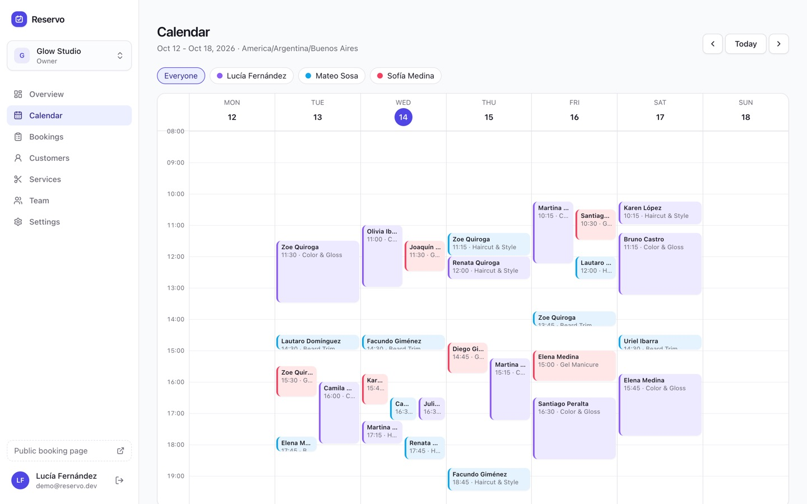

<table>
  <tr>
    <td width="50%">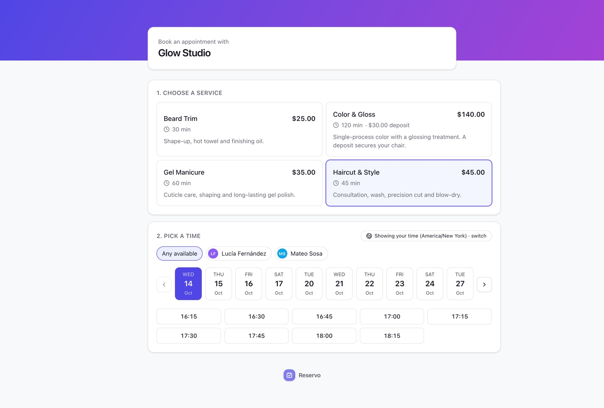<br><sub><b>Public booking page.</b> Service, staff, date and time, shown in the visitor's zone with a one-click switch.</sub></td>
    <td width="50%">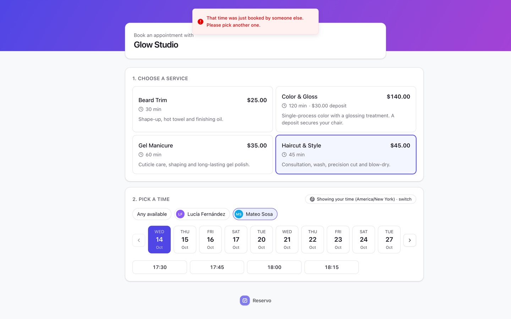<br><sub><b>Lost race.</b> Two tabs booked the same slot: the second gets a 409, a toast and fresh availability.</sub></td>
  </tr>
  <tr>
    <td width="50%">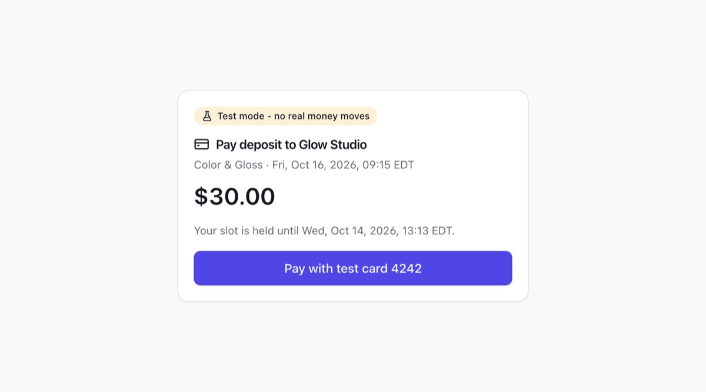<br><sub><b>Deposit checkout.</b> The slot is held until payment; locally the signed fake provider stands in for Stripe.</sub></td>
    <td width="50%">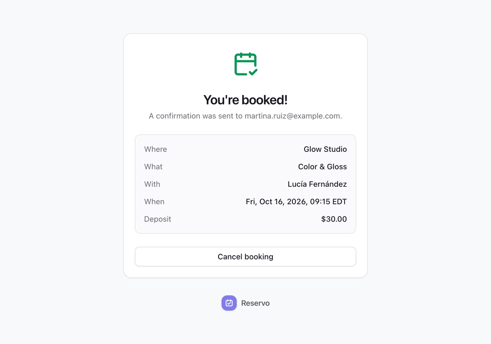<br><sub><b>Confirmation.</b> Confirmed by the payment webhook, with a self-service cancel link.</sub></td>
  </tr>
  <tr>
    <td width="50%">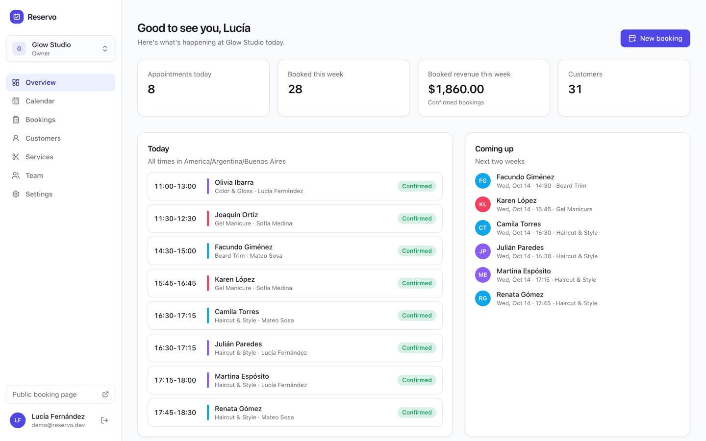<br><sub><b>Overview.</b> Today's agenda, the next two weeks and the week's numbers.</sub></td>
    <td width="50%">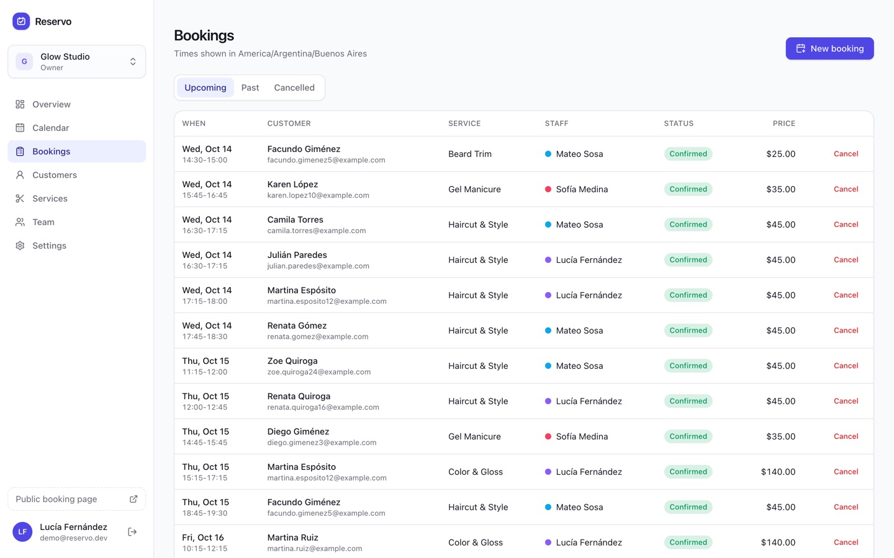<br><sub><b>Bookings.</b> Upcoming, past and cancelled, in the business's time zone.</sub></td>
  </tr>
  <tr>
    <td width="50%">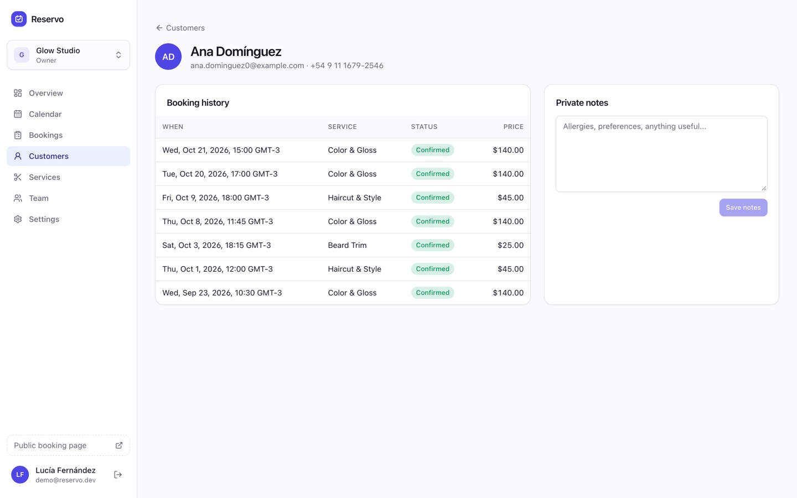<br><sub><b>Customer.</b> Booking history and private notes.</sub></td>
    <td width="50%">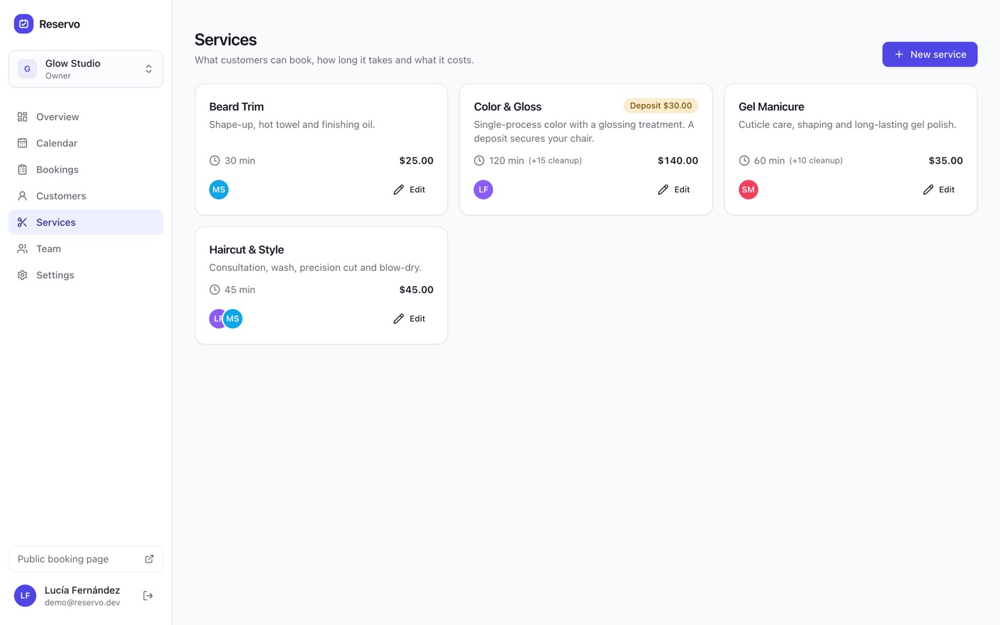<br><sub><b>Services.</b> Duration, price, deposit, cleanup buffers and who performs each one.</sub></td>
  </tr>
  <tr>
    <td width="50%">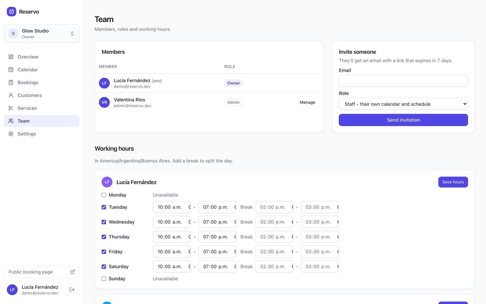<br><sub><b>Team.</b> Roles, invitations and weekly hours split by breaks.</sub></td>
    <td width="50%">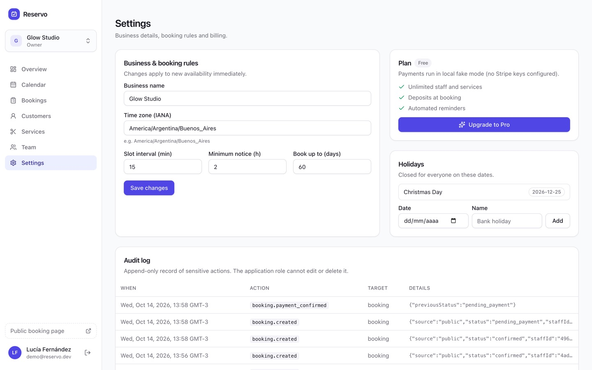<br><sub><b>Settings.</b> Booking rules, holidays, billing and the append-only audit log.</sub></td>
  </tr>
  <tr>
    <td colspan="2">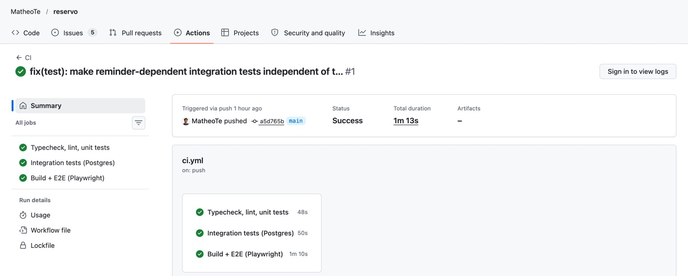<br><sub><b>CI.</b> Typecheck, lint and unit tests, integration tests on real Postgres, build and Playwright E2E.</sub></td>
  </tr>
</table>

---

## What's inside

- **Public booking flow**: service -> staff (or "any available") -> date -> time -> details.
  Times are shown in the visitor's zone with a one-click switch to the business's zone.
  A lost race returns `409 SLOT_UNAVAILABLE`, the UI refreshes availability and keeps
  what the customer typed. Deposits go through Stripe Checkout (or the local fake) and the
  slot is _held_ until payment or expiry.
- **Dashboard**: overview, week calendar (lanes for overlapping bookings, staff filter),
  bookings (create, cancel with notification), customers with history and private notes,
  services (duration, price, deposit, prep/cleanup buffers, who performs it), team (invites,
  roles, removal, weekly hours with breaks), settings (booking rules, holidays, billing, audit log).
- **Availability engine**: a pure module that turns weekly hours, breaks, date overrides,
  holidays, time off, buffers, existing bookings, notice and horizon into bookable slots,
  correctly across time zones and DST transitions. 100+ unit tests.
- **Tenant isolation** with Postgres RLS, enforced for a database role that cannot bypass it.
- **No double booking**, guaranteed by an exclusion constraint.
- **Webhooks done right**: signature verification, idempotency ledger, transactional side effects.
- **Transactional outbox** + worker for confirmation, reminder, cancellation and invitation
  emails and for refunds, with leases, exponential backoff with jitter and dead-lettering.
- **RBAC** (owner / admin / staff) enforced server-side; **append-only audit log**.
- **Rate limiting** on public endpoints (shared across instances), honeypot field, strict zod validation.

---

## Architecture

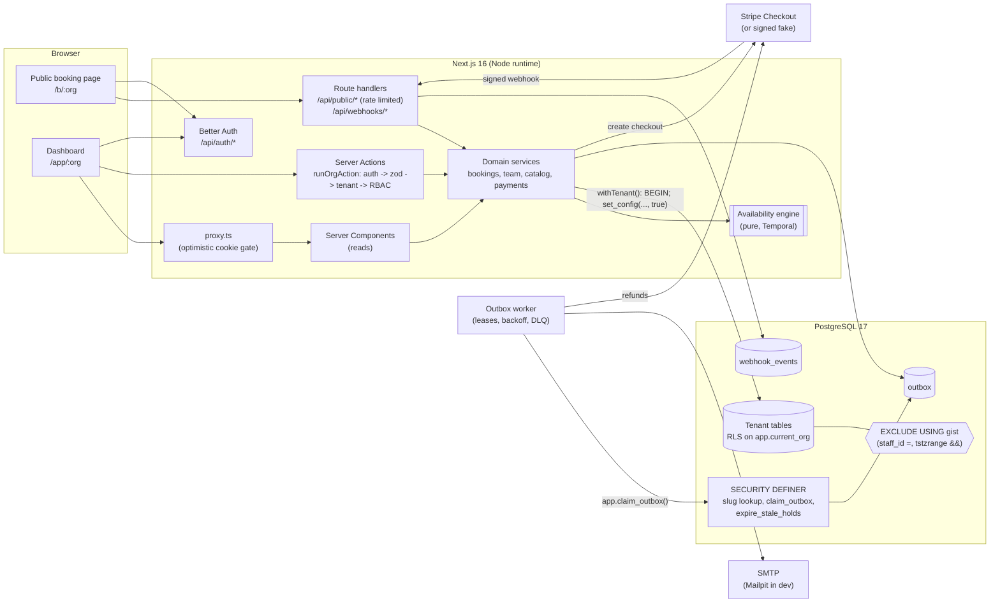

### Booking flow (with a deposit)

```mermaid
sequenceDiagram
  autonumber
  actor C as Customer
  participant W as Booking page
  participant A as POST /api/public/:org/bookings
  participant DB as Postgres (RLS)
  participant S as Stripe
  participant H as POST /api/webhooks/stripe
  participant Q as Outbox worker

  C->>W: pick service, time, details
  W->>A: JSON (zod-validated, rate limited, honeypot)
  A->>DB: BEGIN, set_config(app.current_org, org, true)
  A->>DB: pg_advisory_xact_lock(staff) in sorted order
  A->>DB: expire stale holds, load rules + busy ranges
  A->>A: availability engine re-validates the exact slot
  A->>DB: INSERT booking (pending_payment, hold_expires_at)
  Note over DB: EXCLUDE constraint rejects overlaps (23P01)<br/>-> next staff member or 409 SLOT_UNAVAILABLE
  A->>DB: COMMIT (hold is visible to everyone)
  A->>S: create Checkout Session (idempotency key = booking id)
  A->>DB: INSERT payment (pending)
  A-->>W: 201 { checkoutUrl }
  W->>S: redirect, customer pays
  S->>H: checkout.session.completed (signed)
  H->>H: verify signature (raw body)
  H->>DB: BEGIN; INSERT webhook_events(event_id) ON CONFLICT DO NOTHING
  alt first delivery
    H->>DB: booking -> confirmed, payment -> succeeded
    H->>DB: INSERT outbox (confirmation, reminder at T-24h), audit row
    H->>DB: COMMIT
  else duplicate delivery
    H->>DB: no-op, COMMIT
  end
  H-->>S: 200
  loop every second
    Q->>DB: app.claim_outbox(batch, lease) FOR UPDATE SKIP LOCKED
    Q->>C: confirmation email (in the customer's time zone)
    Q->>DB: mark done (or retry with backoff / dead-letter)
  end
```

### Data model

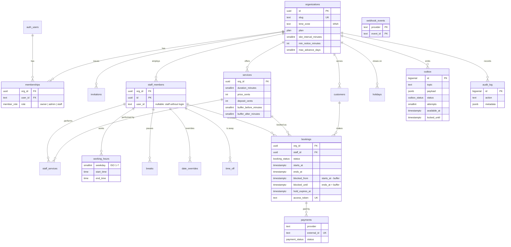

All references inside a tenant are **composite foreign keys** `(org_id, x_id) -> x(org_id, id)`.

---

## Design decisions & trade-offs

### Tenant isolation: Row Level Security instead of `WHERE org_id = ?`

Application-level filtering is one forgotten `where` away from a data leak, and the bug is
silent. Here every tenant table has a policy keyed on a transaction-local setting:

```sql
CREATE POLICY tenant_isolation ON bookings
  USING (org_id = app.current_org_id())
  WITH CHECK (org_id = app.current_org_id());
```

- **The app connects as `reservo_app`**: `NOSUPERUSER NOBYPASSRLS`, owns no tables. Tables use
  `FORCE ROW LEVEL SECURITY` too, so even the owner is filtered. Migrations run as a separate
  privileged role.
- **Context is set per transaction** by `withTenant()` with `set_config('app.current_org', $1, true)`.
  The `true` (is_local) is what makes this safe with a connection pool: the setting dies with
  `COMMIT`/`ROLLBACK`, there is nothing to "reset" and nothing to forget. Unset context = `NULL`
  = every policy is false: **the system fails closed**.
- **Least privilege by omission**: no `DELETE` on `bookings` (cancel instead), no `DELETE` on
  organizations, `audit_log` is `INSERT`/`SELECT` only, so the app can't rewrite history.
- **RLS doesn't cover foreign keys** (FK checks bypass policies), so cross-table references use
  composite keys `(org_id, staff_id)`: a row in org A can't point at org B's staff member.
- **Crossing the boundary is explicit**: the only cross-tenant operations (public slug -> id,
  invitation token -> org, outbox claiming, expiring holds) are tiny `SECURITY DEFINER`
  functions with a pinned `search_path`, `EXECUTE` granted only to the app role.
- **Proof**: `tests/integration/rls.test.ts` runs deliberately buggy queries as the app role:
  unfiltered selects, cross-tenant inserts/updates/deletes, moving rows between tenants,
  cross-tenant FKs, context leakage across pooled connections, garbage context.

Trade-off: RLS adds a predicate to every query and makes ad-hoc admin queries need a
privileged role. For multi-tenant data that's a price worth paying.

### No double booking: an exclusion constraint, not a `SELECT` before `INSERT`

"Check availability, then insert" is a race under concurrency. The guarantee lives in the schema:

```sql
ALTER TABLE bookings ADD CONSTRAINT bookings_no_overlap
  EXCLUDE USING gist (staff_id WITH =, tstzrange(blocked_from, blocked_until, '[)') WITH &&)
  WHERE (status IN ('pending_payment', 'confirmed'));
```

- Half-open ranges (`[)`) let back-to-back appointments touch.
- The blocked range includes the service's **buffers**, so cleanup time is protected too.
- Holds awaiting payment count; cancelled/expired bookings don't.
- `btree_gist` provides `=` on `uuid` inside a GiST index.

The availability engine still re-validates the requested slot (working hours, breaks, time off
are business rules a constraint can't express), but correctness never depends on it.

**What the concurrency tests taught me**: optimistic inserts alone degrade badly. Unlike unique
indexes, exclusion constraints have no speculative insertion, so two in-flight overlapping
inserts wait on each other and Postgres kills one as a deadlock victim (after `deadlock_timeout`).
With 25 parallel requests for one slot this snowballed into timeouts. The fix is layered:
transaction-scoped **advisory locks per staff member, taken in sorted order** (no lock-order
deadlocks) so losers read committed state and fail fast, plus a savepoint retry on `40P01` as a
safety net. The constraint stays the source of truth. See `tests/integration/double-booking.test.ts`.

### Outbox instead of sending email inside the request

Sending email (or anything over the network) inside a DB transaction is wrong both ways: the
email can go out for a booking that then rolls back, or the booking commits and the process
dies before the email is sent. The outbox row is written **in the same transaction** as the
booking, so they commit or roll back together. A worker delivers at-least-once:

- `app.claim_outbox()` leases a batch with `FOR UPDATE SKIP LOCKED` (many workers, no double
  claims); a crashed worker's lease simply expires and the message is re-delivered.
- Failures retry with exponential backoff and jitter (5s, 10s, 20s ... capped at 30 min), then
  go to a `dead` state. Payloads are re-validated with zod; malformed ones dead-letter immediately.
- Reminders are just messages with `available_at = starts_at - 24h`; the handler re-checks the
  booking is still confirmed. Invitation tokens are scrubbed from the payload after delivery.

Trade-offs: delivery is at-least-once, so a rare duplicate email is possible (acceptable);
refunds are made idempotent with a Stripe idempotency key. Magic-link emails are sent inline
because the user is waiting on that screen and there's no tenant transaction to join.

### Webhooks

The handler reads the **raw body**, verifies the signature (Stripe's SDK, or the same
`t=,v1=` HMAC scheme for the fake provider, with timestamp tolerance and constant-time compare),
then in one transaction inserts the event id into `webhook_events` and applies side effects.
A redelivery hits the primary key and becomes a no-op; a failure rolls back the ledger row too,
so the provider's retry gets a clean second chance. Edge case handled: **payment arrives after
the hold expired**. If the slot is still free the booking is revived; if someone else took it,
a refund is queued through the outbox.

Deposit checkout is two-phase: the hold commits _before_ calling Stripe, so no transaction or
row lock is held across a network call; if creating the session fails the hold is released
immediately.

### Time zones

- **Rules are wall-clock, bookings are instants.** Opening hours are `time` + the org's IANA zone
  ("09:00 in Buenos Aires"), because that's how owners think. Bookings are `timestamptz`.
- **The engine is pure**: `now` is injected, no `Date` parsing of local strings, no dependence on
  the server's `TZ`. All conversions go through Temporal.
- **Candidate start times are wall-clock grid points** resolved per day: a time that doesn't
  exist (spring-forward gap) is skipped, a time that happens twice (fall-back) is offered twice
  as two distinct instants. Window boundaries use RFC 5545 "compatible" disambiguation.
- **Display happens in the viewer's zone**: slots are grouped by the customer's calendar day,
  confirmations are formatted in the zone the customer booked from, and the dashboard uses the
  org zone. Browser zone ids are canonicalized (`America/Buenos_Aires` vs
  `America/Argentina/Buenos_Aires`).
- Tested against New York and Madrid transitions, Lord Howe Island's 30-minute DST and
  date-line zones (`Pacific/Kiritimati`).

### Auth: Better Auth over Auth.js

Auth.js v5 has been in beta for a long time and its credentials provider is deliberately
limited; Better Auth is stable, ships email + password and magic link as first-class plugins,
stores sessions in our own Postgres through the Drizzle adapter (no extra service), and works
with Server Actions via `nextCookies()`. Organizations, memberships and invitations are
modelled by hand rather than with its organization plugin, because they have to live under
our RLS policies.

### Server-side RBAC and the action runner

Every dashboard mutation goes through `runOrgAction(slug, permission, schema, input, handler)`:
authenticate -> zod-parse -> resolve tenant -> load membership _inside_ RLS -> check permission ->
run the handler in the same transaction -> return a typed `ActionResult`. Individual actions
can't skip a step. Finer rules (staff can only touch their own bookings and schedule, admins
can't create owners, the last owner can't be removed) live in the services and are covered by
integration tests. Sensitive actions write an audit row in the same transaction.

### Other choices

- **Rate limiting in Postgres** (fixed window, one atomic upsert): shared by every instance with
  no extra infrastructure; the trade-off vs. a sliding window (2x burst at the boundary) is fine
  for abuse protection. Redis would be the next step at scale.
- **Payments behind a port** (`PaymentProvider`): Stripe when keys exist, otherwise a fake that
  signs events and posts them through the exact same verify -> idempotent-apply pipeline, so the
  whole product, deposits included, runs with zero credentials.
- **Typed errors**: one `AppError` with stable codes, mapped to HTTP statuses / action results in
  exactly one place; Postgres `23P01`, `23505`, `42501`, `40P01` are translated there too.

### Bugs the tests caught while building this

Kept here because they're the most honest documentation of why the tests exist:

1. **Deadlock storm under contention** (concurrency test) -> sorted advisory locks + savepoint retry.
2. **Role borrowing across tenants** (smoke test with seeded data): the memberships policy allowed
   `user_id = current_user` inside a tenant transaction, so the owner of org A browsing org B had
   their _A_ membership returned by a lookup that only filtered by user. Fixed in migration
   `0002` (cross-org visibility only when no tenant is bound) and by filtering explicitly; covered
   by an integration and an E2E regression test.
3. **`instanceof` across Next.js server chunks** (deposit E2E): the cached payment provider failed
   `instanceof` in server actions because the module was bundled twice. Now detected by name.

---

## Local setup

Requirements: Node 22.12+ (24 recommended), Docker.

```bash
cp .env.example .env
docker compose up -d          # Postgres on :5433, Mailpit on :1025 / UI :8025
npm install
npm run db:migrate            # applies migrations, provisions the reservo_app login
npm run seed                  # two demo businesses with ~3 weeks of bookings
npm run dev                   # Next.js on :3000 + the outbox worker
```

- Dashboard: <http://localhost:3000/sign-in> - `demo@reservo.dev` / `reservo-demo-2026`
  (owner of Glow Studio) or `admin@reservo.dev` (admin).
- Public booking page: <http://localhost:3000/b/glow-studio> and `/b/northside-physio`
  (Madrid, to see the time-zone toggle).
- Emails (confirmations, magic links, invitations): <http://localhost:8025>.
- Start over: `npm run db:reset && npm run seed`.

### Stripe (optional)

Without keys, deposits and the Pro upgrade use the local fake checkout. To use Stripe test mode:

```bash
STRIPE_SECRET_KEY=sk_test_...
STRIPE_PRO_PRICE_ID=price_...            # a recurring price in test mode
stripe listen --forward-to localhost:3000/api/webhooks/stripe
STRIPE_WEBHOOK_SECRET=whsec_...          # printed by `stripe listen`
```

Pay with `4242 4242 4242 4242`. Handled events: `checkout.session.completed`,
`checkout.session.async_payment_succeeded`, `checkout.session.expired`,
`customer.subscription.deleted`.

---

## Testing

| Command                    | What it runs                                                                                               |
| -------------------------- | ---------------------------------------------------------------------------------------------------------- |
| `npm run test:unit`        | Availability engine, interval math, DST helpers, RBAC matrix, signatures, backoff, validation, layout      |
| `npm run test:integration` | Real Postgres as the app role: RLS, exclusion constraint, concurrency, webhooks, outbox, RBAC, rate limits |
| `npm run test:e2e`         | Playwright against `next build && next start`                                                              |
| `npm run ci`               | typecheck + lint + format check + unit + integration + build                                               |

Integration tests create and migrate a separate `reservo_test` database (override with
`TEST_DATABASE_URL` / `TEST_DATABASE_ADMIN_URL`). E2E expects a migrated database and a build;
locally `PW_CHANNEL=chrome npm run test:e2e` reuses an installed Chrome.

Highlights:

- `src/lib/availability/engine.test.ts` - hours, split shifts, breaks, overrides, holidays, time off,
  buffers, notice/horizon, zones, DST gaps/overlaps (NY, Madrid, Lord Howe), validation.
- `tests/integration/double-booking.test.ts` - 25 parallel requests for one slot -> exactly one wins;
  "any staff" fills each member exactly once.
- `tests/integration/webhooks.test.ts` - duplicate and _concurrent_ duplicate deliveries apply once;
  forged signatures never touch the DB; late payment -> revive or refund.
- `tests/integration/outbox.test.ts` - atomicity with the business write, backoff, dead-lettering,
  lease expiry, two workers never double-deliver.
- `tests/e2e/booking-flow.spec.ts` - sign up -> create org -> add service -> public booking -> dashboard,
  deposit via checkout + signed webhook, and an owner of another org getting a 404.

CI (`.github/workflows/ci.yml`) runs three jobs: quality (typecheck, lint, format, unit),
integration (Postgres 17 service container) and build + E2E (Postgres service container, Chromium).

---

## Project structure

```
drizzle/                    SQL migrations (0001 = RLS, roles, exclusion constraint, definer fns)
docker/postgres/init/       creates the test database in docker-compose
scripts/                    migrate, reset, seed
src/
  app/
    (auth)/                 sign-in / sign-up (password + magic link)
    app/[org]/              dashboard: overview, calendar, bookings, customers, services, team, settings
    b/[org]/                public booking page, booking status/cancel, fake checkout
    api/                    auth, public availability/bookings, webhooks (stripe, fake), health
    onboarding/ invite/     org creation, invitation acceptance
  components/               ui primitives, booking widget, dashboard shell
  db/schema.ts              Drizzle schema (tables, enums, checks, composite FKs)
  lib/
    availability/           the pure availability engine (+ tests)
    calendar*.ts            calendar math and lane layout (+ tests)
    validation.ts           zod schemas shared by client and server
  server/
    db/                     client, withTenant/withUser, slug lookup
    auth/                   Better Auth config, session helpers, RBAC
    actions/                server actions (all through runOrgAction)
    services/               domain logic: bookings, availability, team, catalog, schedule...
    payments/               port, Stripe adapter, signed fake, webhook application
    outbox/ mail/           outbox enqueue/topics/backoff, mailer + templates
    rate-limit.ts audit.ts errors.ts http.ts
  worker/                   outbox processor, handlers, main loop
  proxy.ts                  optimistic auth gate (Next 16 "middleware")
tests/
  integration/              Vitest against Postgres (global setup migrates a fresh DB)
  e2e/                      Playwright
```

---

## Roadmap

- Rescheduling (customer and staff) with the same hold/constraint semantics.
- Cancellation policies (cutoff windows, deposit forfeiture) and partial refunds.
- Recurring appointments and packages.
- Two-way Google/Microsoft calendar sync as an extra source of busy ranges.
- SMS/WhatsApp reminders as additional outbox topics.
- Resource scheduling (rooms, chairs) as a second exclusion dimension.
- Per-tenant custom domains and branding for the booking page.
- Observability: OpenTelemetry traces across request -> outbox -> worker, metrics on queue lag.
- Redis-backed sliding-window rate limiting when traffic justifies it.
- i18n (the formatting layer is already locale-aware).

---

## License

[MIT](./LICENSE)

---

Built by **Matheo Telesca** - [LinkedIn](https://www.linkedin.com/in/matheo-telesca-084a20209/)
